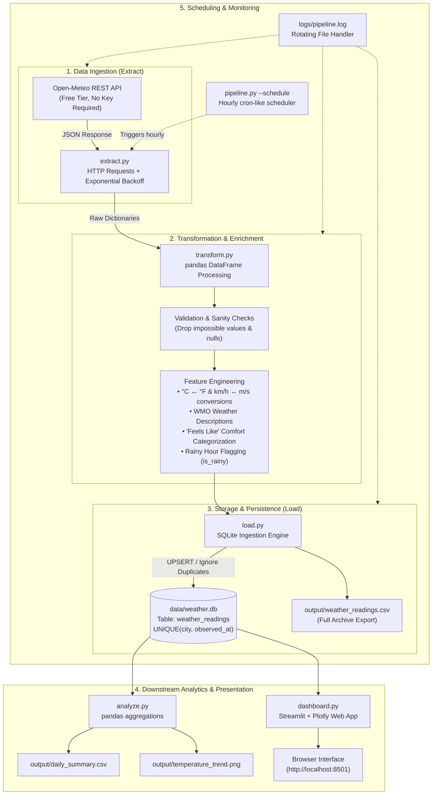

# 🌤️ Weather ETL Pipeline & Interactive Analytics Dashboard

[](https://www.python.org/)
[](https://www.sqlite.org/)
[](https://streamlit.io/)
[](https://plotly.com/)
[](https://open-meteo.com/)

An end-to-end automated **Extract, Transform, Load (ETL)** data pipeline and interactive analytics web application built in Python. 

The pipeline extracts hourly meteorological observations for five major Indian metropolitan centers (**Mumbai**, **Delhi**, **Bengaluru**, **Chennai**, and **Kolkata**) from the free [Open-Meteo REST API](https://open-meteo.com/). It cleans, validates, and enriches the data using **pandas**, persists it into an **SQLite** relational database with strict idempotency guarantees, and serves insights through an interactive **Streamlit** and **Plotly** dashboard.

---

## 📑 Table of Contents

- [System Architecture](#-system-architecture)
- [Key Features](#-key-features)
- [Project Structure](#-project-structure)
- [Database Schema](#-database-schema)
- [Installation & Setup](#-installation--setup)
- [Running the Pipeline](#-running-the-pipeline)
- [Interactive Dashboard](#-interactive-dashboard)
- [Analytical Queries](#-analytical-queries)
- [Tech Stack](#-tech-stack)

---

## 🏛️ System Architecture



---

## ✨ Key Features

### 1. Robust Extraction (`extract.py`)
- Direct integration with Open-Meteo's weather forecasting and historical endpoints.
- Configurable city coordinate mapping for **Mumbai**, **Delhi**, **Bengaluru**, **Chennai**, and **Kolkata**.
- Built-in network resilience featuring **exponential backoff retry strategies** and configurable HTTP timeouts to prevent silent execution failures.
- Multi-day historical lookback (`PAST_DAYS = 7`) ensures immediate trend availability upon the very first pipeline run.

### 2. Rigorous Data Transformation (`transform.py`)
- **Sanity Auditing**: Verifies temperatures fall within physically possible bounds (-50°C to +60°C) and relative humidity stays within 0% to 100%.
- **Deduplication & Null Handling**: Identifies and drops null measurements or duplicate timestamps before storage.
- **Unit Conversions**: Simultaneously generates Celsius (°C) and Fahrenheit (°F) temperatures, as well as km/h and m/s wind velocities.
- **WMO Code Translation**: Decodes standard WMO meteorological codes (e.g., Code 61 → *"Slight rain"*, Code 0 → *"Clear sky"*).
- **Thermal Comfort Categorization**: Computes perceived temperature classes:
  - `Cold` (< 10°C)
  - `Cool` (10°C – 18°C)
  - `Comfortable` (18°C – 24°C)
  - `Warm` (24°C – 30°C)
  - `Hot` (30°C – 38°C)
  - `Extreme heat` (> 38°C)
- **Precipitation Flagging**: Binary `is_rainy` indicator (`1` when precipitation > 0 mm, else `0`) for quick rain-hour analysis.

### 3. Idempotent SQLite Ingestion (`load.py`)
- Automatically initializes table schemas with index constraints.
- Employs a strict **`UNIQUE(city, observed_at)`** composite key constraint using `INSERT OR IGNORE` logic. The pipeline can be executed repeatedly or continuously without duplicating records.
- Creates backup exports to CSV in the `output/` directory on every pipeline run.

### 4. Interactive Web Dashboard (`dashboard.py`)
- **Modern Wide-Screen Layout**: Designed using Streamlit and dynamic Plotly charts with consistent city color-coding.
- **Responsive Caching**: Database queries are cached for 5 minutes (`@st.cache_data(ttl=300)`), keeping dashboard interactions fast while allowing seamless live refreshes.
- **Dynamic Unit Switching**: On-the-fly toggling between **Celsius (°C)** and **Fahrenheit (°F)** updates all KPI cards, chart axes, hover tooltips, and data views.
- **Timezone Awareness**: Converts stored UTC timestamps to Indian Standard Time (`Asia/Kolkata`) for intuitive local interpretation.
- **Defensive Design**: Displays clear, helpful guidance if the database is uninitialized instead of throwing raw database errors.

---

## 📁 Project Structure

```
Weather-ETL-Pipeline/
├── config.py             # Central pipeline settings (cities, coordinates, paths, retry policies)
├── logger_setup.py       # Dual-stream logging configuration (terminal output + rotating file)
├── extract.py            # Extraction: Open-Meteo API connector with exponential backoff
├── transform.py          # Transformation: Cleaning, validating, and feature enrichment
├── load.py               # Loading: SQLite schema creation, insertion, and CSV backup
├── analyze.py            # Analysis: Daily aggregations, summary CSVs, and trend plotting
├── pipeline.py           # Pipeline Orchestrator: Command-line entry point & hourly runner
├── dashboard.py          # Interactive Streamlit & Plotly analytics dashboard
├── requirements.txt      # Project dependencies
├── .gitignore            # Excludes virtual environments, SQLite DBs, logs, and artifacts
├── data/                 # SQLite database storage (auto-created on first run)
│   └── weather.db        # SQLite database holding historical weather readings
├── logs/                 # Execution logs (auto-created)
│   └── pipeline.log      # Rotating log file capturing pipeline executions
├── output/               # Analytical outputs (auto-created)
│   ├── weather_readings.csv  # Full database tabular dump
│   ├── daily_summary.csv     # Daily aggregated meteorological metrics
│   └── temperature_trend.png # Matplotlib static trend chart
└── screenshots/          # Documentation and report visualizations
    └── temperature_trend.png
```

---

## 🗄️ Database Schema

The SQLite database is located at `data/weather.db` and stores data in the `weather_readings` table:

| Column Name | SQLite Type | Unit / Format | Description |
|---|---|---|---|
| `id` | `INTEGER` | Auto-increment | Primary surrogate key |
| `city` | `TEXT` | Nominal | City name (`Mumbai`, `Delhi`, `Bengaluru`, `Chennai`, `Kolkata`) |
| `observed_at` | `TEXT` | `YYYY-MM-DD HH:MM:SS` | UTC observation timestamp (**Unique per city**) |
| `temperature_c` | `REAL` | °C | Air temperature at 2 meters above ground level |
| `temperature_f` | `REAL` | °F | Converted temperature in Fahrenheit |
| `feels_like_c` | `REAL` | °C | Apparent (perceived) temperature |
| `humidity_pct` | `REAL` | % (0–100) | Relative atmospheric humidity |
| `precipitation_mm` | `REAL` | mm | Hourly liquid precipitation amount |
| `wind_speed_kmh` | `REAL` | km/h | Wind velocity measured at 10 meters |
| `wind_speed_ms` | `REAL` | m/s | Converted wind velocity in meters per second |
| `weather_code` | `INTEGER` | Code | Standard WMO numeric weather classification code |
| `weather_description` | `TEXT` | String | Human-readable condition (e.g., *"Clear sky"*, *"Moderate rain"*) |
| `feels_like_category` | `TEXT` | Category | Thermal comfort class (*Cold, Cool, Comfortable, Warm, Hot, Extreme heat*) |
| `is_rainy` | `INTEGER` | 0 or 1 | Rain indicator flag (`1` if `precipitation_mm > 0`, otherwise `0`) |
| `ingested_at` | `TEXT` | `YYYY-MM-DD HH:MM:SS` | UTC audit timestamp when row was inserted |

**Constraint**: `UNIQUE(city, observed_at)` ensures strict data integrity.

---

## ⚙️ Installation & Setup

### Prerequisites
- **Python 3.10+**
- Git

### 1. Clone the Repository
```bash
git clone https://github.com/dmittal17/Weather-ETL-Pipeline.git
cd Weather-ETL-Pipeline
```

### 2. Create and Activate a Virtual Environment
```bash
# macOS / Linux:
python3 -m venv venv
source venv/bin/activate

# Windows (Command Prompt / PowerShell):
python -m venv venv
venv\Scripts\activate
```

### 3. Install Dependencies
```bash
pip install -r requirements.txt
```

---

## 🚀 Running the Pipeline

The project includes an orchestrator (`pipeline.py`) that executes the **Extract → Transform → Load → Analyze** sequence in order.

### One-Off Execution (Manual Run)
Fetches recent history, cleans data, writes to SQLite, updates output CSVs, and produces summary charts:
```bash
python pipeline.py
```

### Scheduled Daemon (Continuous Monitoring)
Keeps the process active, automatically fetching fresh observations every hour:
```bash
python pipeline.py --schedule
```

---

## 📊 Interactive Dashboard

The Streamlit dashboard offers an interactive view into the weather data.

### Launching the Dashboard
Run the following command inside the virtual environment:
```bash
streamlit run dashboard.py
```
Your browser will open automatically to **`http://localhost:8501`**.

### Dashboard Features

1. **Sidebar Controls**:
   - **City Multiselect**: Filter observations for one or multiple cities simultaneously.
   - **Date Range Picker**: Select specific observation periods.
   - **Temperature Unit Toggle (°C / °F)**: Dynamically toggles all metric cards, chart axes, and tables between Celsius and Fahrenheit.
   - **Refresh Data Button**: Immediately flushes cached queries (`ttl=300`) to pull the latest database state.

2. **Top KPI Metrics**:
   - **Latest City Readings**: Individual cards displaying the most recent temperature, weather description, and comfort category for each selected city.
   - **Aggregate Highlights**: Quick-reference indicators showing Average Temperature, Average Humidity, Total Rainfall (mm), and Total Rainy Hours for the selected period.

3. **Three Navigation Tabs**:
   - **Overview Tab**:
     - *Latest Readings Table*: Formatted snapshot showing the newest reading per city.
     - *Daily Average Temperature*: Grouped bar chart comparing daily average temperatures.
     - *Total Daily Rainfall*: Grouped bar chart showing total daily rainfall in millimeters.
     - *Average Wind Speed*: Horizontal/vertical bar chart showing wind velocity by city.
     - *Comfort Category Distribution*: Interactive donut chart showing the breakdown of hours spent in each "feels like" category.
   - **Trends Tab**:
     - *Hourly Temperature Trend*: Multi-series line chart tracking temperatures over time with unified crosshair hover tooltips.
     - *Hourly Humidity Trend*: Interactive multi-line chart tracking relative humidity variations.
     - *City & Hour Heatmap*: 24-hour diurnal matrix showing mean temperature patterns for each hour of the day (00:00 to 23:00) per city.
   - **Details Tab**:
     - Complete filterable data table with clean timestamps.
     - **CSV Export**: Includes a **"📥 Download Filtered Data as CSV"** button to export the current filtered view for spreadsheet analysis.

---

## 🔍 Analytical Queries

You can query `data/weather.db` using any SQLite client or the Python CLI:

### 1. Average Temperature and Total Rainfall per City
```sql
SELECT 
    city,
    ROUND(AVG(temperature_c), 2) AS avg_temp_c,
    ROUND(SUM(precipitation_mm), 2) AS total_rain_mm,
    SUM(is_rainy) AS total_rainy_hours
FROM weather_readings
GROUP BY city
ORDER BY avg_temp_c DESC;
```

### 2. Warmest and Coldest Hour Recorded for Each City
```sql
SELECT 
    city,
    MIN(temperature_c) AS min_temp_c,
    MAX(temperature_c) AS max_temp_c,
    ROUND(MAX(temperature_c) - MIN(temperature_c), 2) AS diurnal_range_c
FROM weather_readings
GROUP BY city;
```

### 3. Distribution of Weather Conditions
```sql
SELECT 
    weather_description,
    COUNT(*) AS total_hours,
    ROUND(COUNT(*) * 100.0 / (SELECT COUNT(*) FROM weather_readings), 1) AS pct_of_time
FROM weather_readings
GROUP BY weather_description
ORDER BY total_hours DESC;
```

---

## 🛠️ Tech Stack

- **Language:** Python 3.10+
- **API Ingestion:** `requests` (with exponential backoff and timeout safeguards)
- **Data Transformation:** `pandas`, `numpy`
- **Database:** `sqlite3` (built-in relational database with ACID compliance)
- **Dashboard UI:** `streamlit`
- **Interactive Visualizations:** `plotly` (Express and Graph Objects)
- **Static Visualizations:** `matplotlib`
- **Task Scheduling:** `schedule`
- **Logging:** Python `logging` (console streaming + rotating file handler)

---

## 📄 License

This project is licensed under the MIT License - feel free to use and modify it for educational or production purposes.
